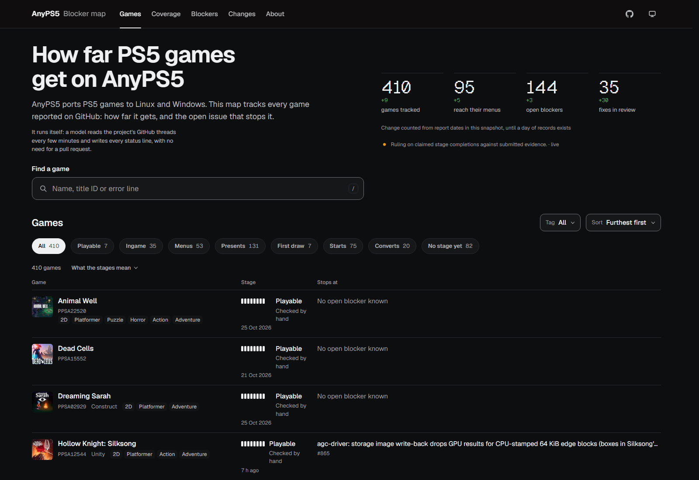
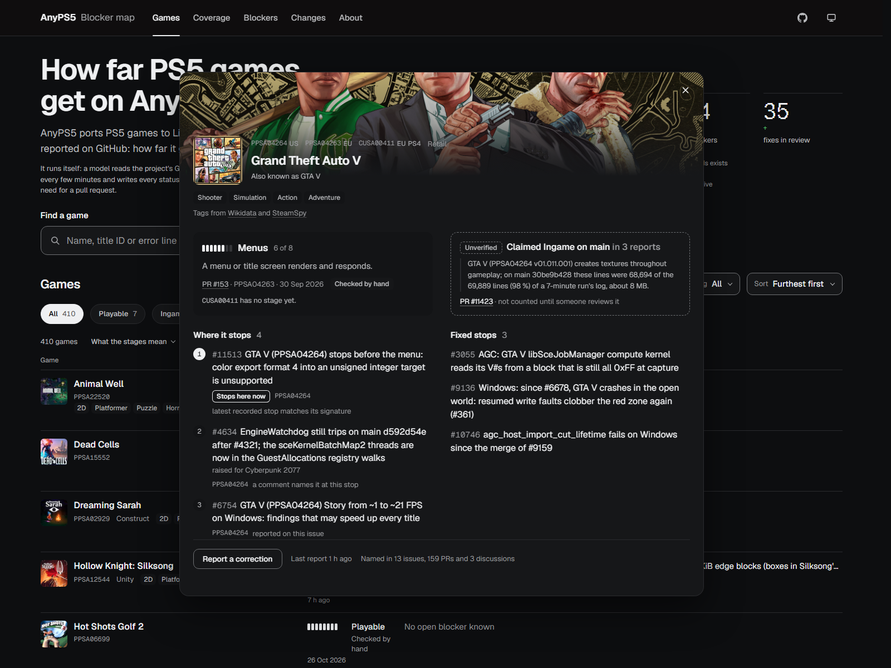
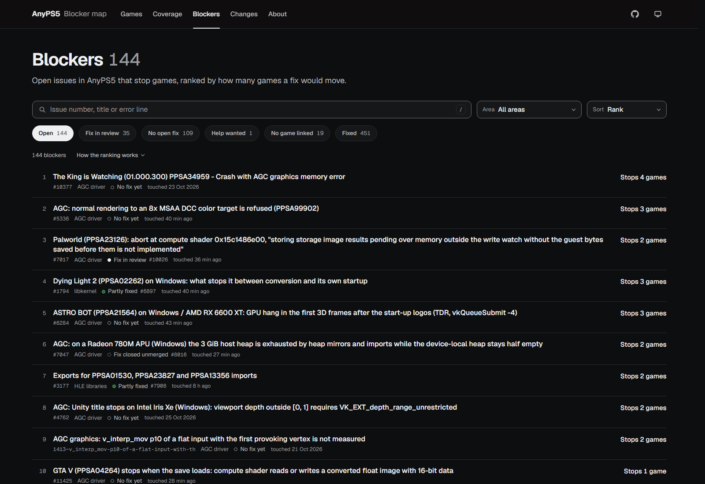
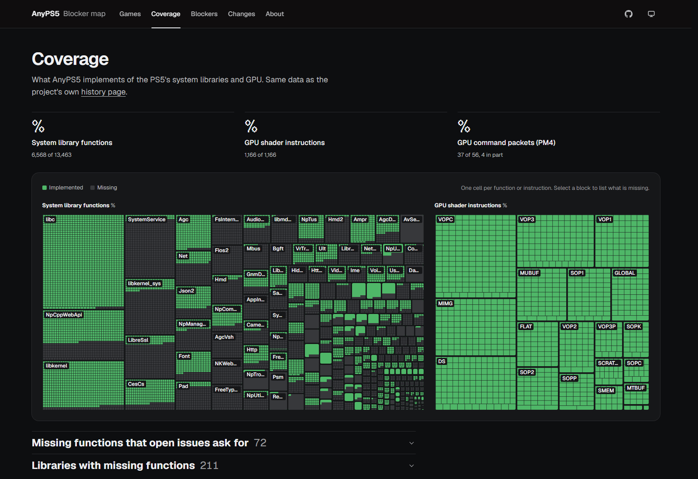
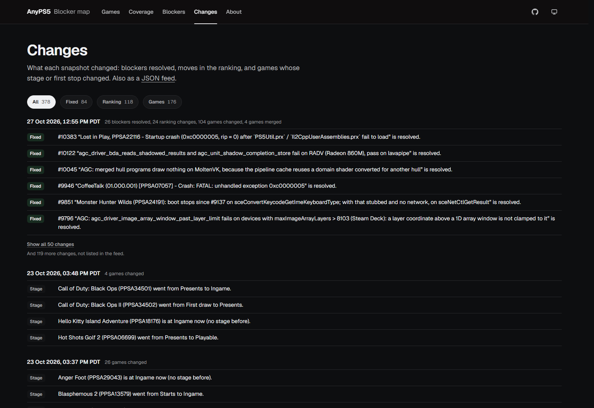

# AnyPS5 blocker map

[AnyPS5](https://github.com/boykopovar/AnyPS5) runs PS5 games on Linux and Windows. This map shows how
far each game gets, which open issue or pull request is in its way, and which single fix would move the
most games forward.

The page is this repository's frontend, built from the files the generator writes. Everything on it
comes from public GitHub data and links its source.

This repository continues [AlxcBTW/anyps5-roadmap](https://github.com/AlxcBTW/anyps5-roadmap), which was
archived in October 2026 with its last build. The generator, the data files, the tests and the page
carried over, and the map has been kept up to date since.

A community project, not an official AnyPS5 page.

## Fully autonomous

There is no maintainer in the loop. Every few minutes the map reads the project's GitHub threads again,
rewrites the status line of every game whose evidence moved, rebuilds itself and publishes the result.
No pull request, no review queue, no scheduled human. Someone tests a build at noon and the map can say
so by the afternoon.



## Why there is no server here

The map is refreshed by a small service that reads upstream threads, writes the status lines and takes
correction reports. That service is deliberately **not** in this repository: it runs with a GitHub token
and a model credential, and a public tree is the wrong place for either. The page is built from what
this repository produces, and nothing here can reach the machine that runs it.

What is open is everything that describes the map - the generator, the curated data, the tests and the
app that draws it - and none of the keys.

## The map

| | |
|---|---|
|  |  |
| A game opens over the list: the stage it reaches, the report behind it, a higher stage that is still only a claim, and every open stop in the order it meets them. | Blockers ranked by how many games one fix would move, with the issue, its area and its fix in review. |

| | |
|---|---|
|  |  |
| Coverage: one cell per system function or GPU instruction, from the project's own history page. | Changes: blockers resolved, ranking moves and stages that rose, also published as a JSON feed. |

## What it shows

- **Stages** - the furthest point a game reaches on `main`: Converts, Loads, Starts, First draw,
  Presents, Menus, Ingame, Playable.
- **Stops** - the open issue or pull request in a game's way, in the order it meets them.
- **Ranking** - 3 points per game where a blocker is the only stop, 2 where it is the first, 1 per game
  that hits it at all. The top of the ranking is where one fix moves the most games.
- **Coverage** - how much of the PS5's system libraries, GPU shader instructions and GPU command
  packets AnyPS5 implements.
- **Changes** - a [JSON Feed](https://www.jsonfeed.org/version/1.1/) of what moved: blockers resolved,
  games whose stage rose, games that took in another title ID.

## A stage is a claim until someone checks it

- A stage counts only when a thread reports it on `main`, or on `main` plus pull requests that are
  merged right now. Hopes, plans, other emulators and anything reached only on a local patch do not
  count.
- A report of Menus or higher waits as a **claim** until a person opens the source and rules on it.
  Until then it is shown as a claim and never ranked on.
- When a thread goes quiet the map says so, instead of implying work that is not happening.

## How the data is made

```text
  boykopovar/AnyPS5 on GitHub                       data/blockers.json, data/games.json
  issues, PRs, discussions, comments                checked by hand; always wins
          |                                                 |
          | read only what changed since the last run       |
          v                                                 |
   the text  -->  rules  -->  titles, blockers, chains  <----+
                                    |
      PlayStation title list --> which title IDs are one game
                                    |
                                    v
              roadmap.json, feed.json  -->  the page, ROADMAP.md, llms.txt
```

1. **Collect.** The threads of the last 60 days, plus every open one, read through the GitHub API, and
   only what changed since the previous run. A warm cache costs about 20 GraphQL points.
2. **Read.** Title IDs, game names, stages, OS, GPU, the build, and the error line that stops a game are
   read from the text line by line. A quoted line is not the quoter's report, and the same sentence
   posted twice counts once.
3. **Group.** Title IDs belong to one game when a person says so in `data/games.json`, when the
   PlayStation Store puts them under one concept, or when their names agree once spelling, symbols,
   editions and short forms like GTA are set aside. Anything less certain goes to a review list instead,
   never into the ranking.
4. **Render.** One file, `site/roadmap.json`, is the whole map. The page, `ROADMAP.md` and `llms.txt`
   are all rendered from it, so people and tools read the same data.

## Run it

Python 3.11 or newer, nothing to install. On Windows use `py -3` for `python3`.

```sh
git clone https://github.com/authurtabo-byte/anyps5-roadmap && cd anyps5-roadmap

python3 -m unittest discover -s tests          # fixture tests, no network
python3 roadmap.py --validate                  # check the two data files

gh auth login                                  # only for live data
python3 roadmap.py --out build/site            # a live build
python3 roadmap.py --offline --out build/site  # rebuild from data/cache/ in seconds

cd web && npm ci && npm run dev                # the page at http://localhost:5173
```

The live build needs the [GitHub CLI](https://cli.github.com/) and writes what it fetched to
`data/cache/`. After that `--offline` rebuilds without touching the network, which is the quick way to
try a change to `data/blockers.json`.

## Correct an entry

- **On the page** - a game or a blocker opens a panel with a *Report a correction* link that prefills
  the issue form with the title ID, the stage shown and its source.
- **In a pull request** - edit `data/blockers.json`, or `data/games.json` to join or separate the title
  IDs of a game. [CONTRIBUTING.md](CONTRIBUTING.md) walks through a first data fix in five minutes; CI
  shows what the change does to the ranking before you merge.

Wrong stages and missing blockers belong here. Bugs in AnyPS5 itself belong in
[AnyPS5's issues](https://github.com/boykopovar/AnyPS5/issues).

## Repository layout

| Path | What it is |
|---|---|
| `anyps5_roadmap/` | The generator: collection, reading, identity, evaluation, assembly, rendering |
| `data/blockers.json`, `data/games.json` | Facts checked by hand, which win over what the text says |
| `site/` | The generated map and its fonts |
| `web/` | The page |
| `docs/` | Notes, screenshots and the decisions behind the page |
| `tests/` | Fixture tests; no network |

## Known limits

- Reading text with rules, one line at a time, handles negation and context only roughly - which is why
  a high stage stays a claim until someone checks it.
- The order of stops is a best guess: the latest recorded one first, then issues by date.
- Reports that only exist on Discord stay invisible until someone copies them to GitHub.
- Homebrew without a title ID shows its initials instead of a cover.
- Covers are links to the PlayStation Store or Steam CDN; nothing is copied here.

The full list, as of the last build, is under **Known gaps** in the map's Data view.

## License

The code is [MIT](LICENSE). Text quoted in the data (issue titles, sentences, error lines) belongs to
its authors upstream; it is quoted with a link to its source and is not relicensed. Covers are linked,
not stored, and belong to their publishers - see [docs/images.md](docs/images.md). The PlayStation title
list is [andshrew/PlayStation-Titles](https://github.com/andshrew/PlayStation-Titles) (MIT). The Geist
fonts are under the SIL Open Font License ([site/fonts/OFL.txt](site/fonts/OFL.txt)).

Not affiliated with the AnyPS5 project or with Sony Interactive Entertainment. PlayStation and PS5 are
trademarks of Sony Interactive Entertainment.
